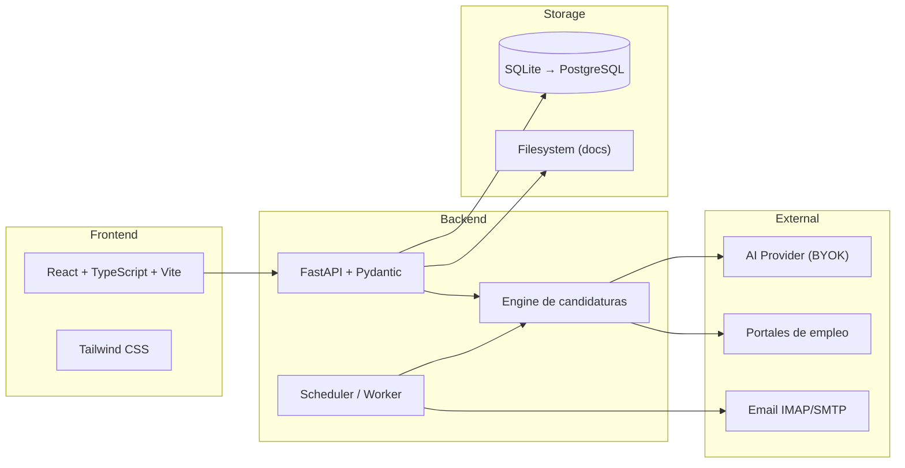

# Máquina de Chamba — Arquitectura

## Visión general

Monolito modular local-first para gestionar búsqueda laboral, personalizar candidaturas y ejecutar postulaciones autorizadas.

## Principios de diseño

1. **Local-first**: todos los datos residen en la máquina del usuario.
2. **Monolito modular**: un solo proceso con módulos desacoplados.
3. **Aprobación obligatoria**: nada se envía sin autorización explícita.
4. **BYOK**: el usuario provee sus propias API keys.
5. **Determinismo primero**: usar reglas antes que IA.
6. **Simulación por defecto**: modo seguro hasta autorización.
7. **Multi-tenant ready**: datos aislados por usuario desde el inicio.

## Módulos

| Módulo | Responsabilidad | Dependencias |
|--------|----------------|-------------|
| `users` | Autenticación, configuración, zona horaria | — |
| `profile` | Perfil profesional, fuentes, verificación | `users` |
| `cv` | CV maestros, documentos, generación PDF/DOCX | `profile` |
| `communication` | Estilo, cuestionario, plantillas de mensaje | `profile` |
| `vacancies` | Descubrimiento, importación, deduplicación | `users` |
| `evaluation` | Compatibilidad, puntuación, justificación | `profile`, `vacancies` |
| `approvals` | Ciclo de revisión, aprobación, registros inmutables | `evaluation`, `cv` |
| `scheduling` | Programación día siguiente, ventanas, zonas horarias | `approvals` |
| `execution` | Cola durable, envío, verificación, evidencia | `scheduling`, `portals` |
| `portals` | Adaptadores por portal, capacidades declaradas | — |
| `email` | IMAP/SMTP, clasificación, borradores | `users` |
| `crm` | Estados, vistas, seguimiento | `execution`, `email` |
| `secrets` | Gestión segura de claves y credenciales | — |
| `audit` | Logs, costos, exportación | todos |

## Stack tecnológico

| Capa | Tecnología | Justificación |
|------|-----------|---------------|
| Frontend | React 18+, TypeScript, Vite, Tailwind CSS | Ecosistema maduro, tipado, build rápido |
| Backend | Python 3.12+, FastAPI, Pydantic v2 | Async nativo, validación robusta, tipado |
| Base de datos | SQLite (MVP) → PostgreSQL | Sin dependencias externas para MVP |
| Migraciones | Alembic | Estándar para SQLAlchemy |
| ORM | SQLAlchemy 2.0 | Async support, typing, mature |
| Scheduler | APScheduler + cola en SQLite | Durable, no requiere Redis/RabbitMQ |
| Documentos | python-docx, reportlab/weasyprint | Generación local de DOCX y PDF |
| Automatización | Playwright (cuando autorizado) | Automatización de navegador |
| AI | LiteLLM o adaptador propio | Proveedores intercambiables |
| Testing | pytest, pytest-asyncio, httpx | Async testing, API testing |
| CI | GitHub Actions | Estándar open source |
| Graphify | Obligatorio en desarrollo | Navegación de codebase |

## Funcionamiento offline vs online

| Funcionalidad | Sin conexión | Requiere conexión | Datos que salen |
|---------------|:---:|:---:|---|
| Gestión de perfil | ✅ | — | Ninguno |
| Edición de CV | ✅ | — | Ninguno |
| Importar vacantes manualmente | ✅ | — | Ninguno |
| Buscar vacantes en portales | — | ✅ | Queries de búsqueda |
| Evaluar compatibilidad con IA | — | ✅ | Datos anonimizados del perfil + vacante |
| Revisar y aprobar | ✅ | — | Ninguno |
| Ejecutar postulaciones | — | ✅ | CV, carta, datos de formulario |
| Dashboard y CRM | ✅ | — | Ninguno |
| Enviar/recibir email | — | ✅ | Contenido de correos |
| Backups | ✅ | — | Ninguno (local) |

## Decisiones de arquitectura

Ver `docs/adr/` para el registro completo de Architecture Decision Records.

## Seguridad

Ver `SECURITY.md` para el modelo de amenazas completo.
