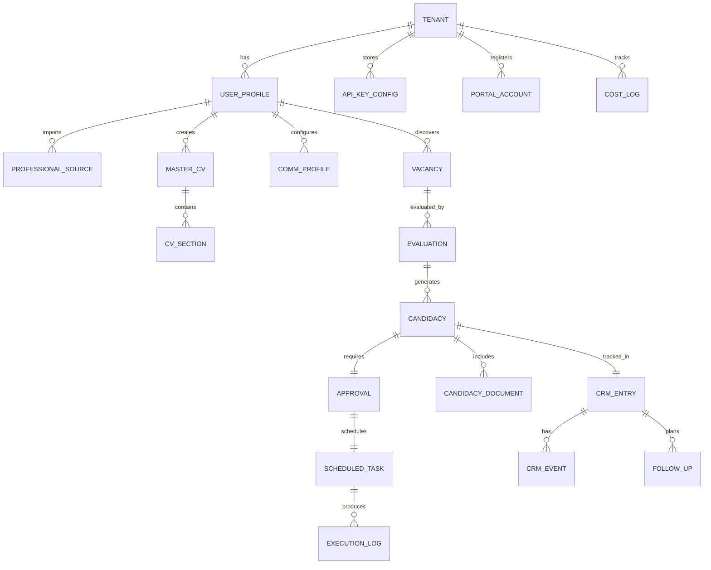
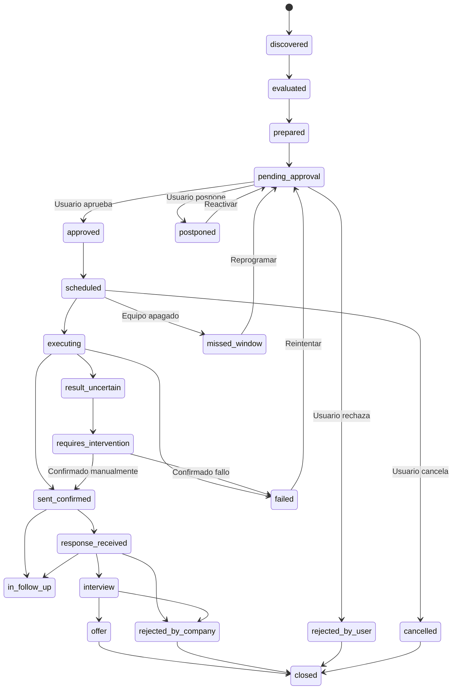

# Máquina de Chamba — Modelo de datos

## Convenciones

- Todas las tablas incluyen `id` (UUID), `tenant_id`, `created_at`, `updated_at`.
- Timestamps en UTC. Zona horaria del usuario se aplica en presentación.
- Soft delete con `deleted_at` donde aplique.
- Versionado con tablas `_history` para documentos aprobados.

## Diagrama entidad-relación

## Tablas principales

### tenants

| Campo | Tipo | Descripción |
|-------|------|------------|
| id | UUID PK | |
| name | VARCHAR(255) | Nombre del tenant |
| timezone | VARCHAR(50) | Zona horaria por defecto |
| simulation_mode | BOOLEAN | `true` por defecto |
| execution_window_start | TIME | Inicio de ventana de ejecución |
| execution_window_end | TIME | Fin de ventana de ejecución |
| created_at | TIMESTAMP | |
| updated_at | TIMESTAMP | |

### user_profiles

| Campo | Tipo | Descripción |
|-------|------|------------|
| id | UUID PK | |
| tenant_id | UUID FK → tenants | |
| full_name | VARCHAR(255) | |
| email | VARCHAR(255) | |
| phone | VARCHAR(50) | |
| location_city | VARCHAR(100) | |
| location_country | VARCHAR(100) | |
| work_countries | JSONB | Lista de países donde puede trabajar |
| availability | VARCHAR(50) | inmediata, 2_weeks, 1_month, etc. |
| job_preferences | JSONB | Tipo, modalidad, salario, etc. |
| languages | JSONB | `[{"lang": "es", "level": "native"}, ...]` |
| profile_status | VARCHAR(20) | draft, pending_review, verified |
| created_at | TIMESTAMP | |
| updated_at | TIMESTAMP | |

### professional_sources

| Campo | Tipo | Descripción |
|-------|------|------------|
| id | UUID PK | |
| tenant_id | UUID FK → tenants | |
| profile_id | UUID FK → user_profiles | |
| source_type | VARCHAR(50) | cv_import, github, manual, portfolio |
| source_uri | TEXT | URL o path del archivo original |
| raw_data | JSONB | Datos extraídos sin procesar |
| verification_status | VARCHAR(20) | pending, verified, rejected |
| verified_at | TIMESTAMP | |
| verified_by | VARCHAR(50) | user, automated |
| notes | TEXT | |
| created_at | TIMESTAMP | |
| updated_at | TIMESTAMP | |

### experiences

| Campo | Tipo | Descripción |
|-------|------|------------|
| id | UUID PK | |
| tenant_id | UUID FK | |
| profile_id | UUID FK → user_profiles | |
| source_id | UUID FK → professional_sources | Origen del dato |
| company | VARCHAR(255) | |
| title | VARCHAR(255) | |
| start_date | DATE | |
| end_date | DATE | NULL = actual |
| description | TEXT | |
| skills_used | JSONB | |
| verification_status | VARCHAR(20) | pending, verified |
| created_at | TIMESTAMP | |
| updated_at | TIMESTAMP | |

### skills

| Campo | Tipo | Descripción |
|-------|------|------------|
| id | UUID PK | |
| tenant_id | UUID FK | |
| profile_id | UUID FK → user_profiles | |
| source_id | UUID FK → professional_sources | |
| name | VARCHAR(100) | |
| category | VARCHAR(50) | technical, soft, language, tool |
| proficiency | VARCHAR(20) | beginner, intermediate, advanced, expert |
| years_experience | FLOAT | |
| verification_status | VARCHAR(20) | extracted, verified, rejected |
| created_at | TIMESTAMP | |
| updated_at | TIMESTAMP | |

### education

| Campo | Tipo | Descripción |
|-------|------|------------|
| id | UUID PK | |
| tenant_id | UUID FK | |
| profile_id | UUID FK → user_profiles | |
| source_id | UUID FK → professional_sources | |
| institution | VARCHAR(255) | |
| degree | VARCHAR(255) | |
| field | VARCHAR(255) | |
| start_date | DATE | |
| end_date | DATE | |
| verification_status | VARCHAR(20) | |
| created_at | TIMESTAMP | |
| updated_at | TIMESTAMP | |

### master_cvs

| Campo | Tipo | Descripción |
|-------|------|------------|
| id | UUID PK | |
| tenant_id | UUID FK | |
| profile_id | UUID FK → user_profiles | |
| name | VARCHAR(100) | "Desarrollo Backend", "QA", etc. |
| specialization | VARCHAR(100) | |
| template_id | VARCHAR(50) | Plantilla visual |
| sections | JSONB | Orden y configuración de secciones |
| is_active | BOOLEAN | |
| version | INTEGER | Incremental |
| created_at | TIMESTAMP | |
| updated_at | TIMESTAMP | |

### master_cv_history

| Campo | Tipo | Descripción |
|-------|------|------------|
| id | UUID PK | |
| cv_id | UUID FK → master_cvs | |
| version | INTEGER | |
| snapshot | JSONB | Copia completa del CV en esa versión |
| created_at | TIMESTAMP | |

### communication_profiles

| Campo | Tipo | Descripción |
|-------|------|------------|
| id | UUID PK | |
| tenant_id | UUID FK | |
| profile_id | UUID FK → user_profiles | |
| tone | VARCHAR(50) | formal, semiformal, casual |
| language_preferences | JSONB | Idiomas y preferencias por contexto |
| writing_rules | JSONB | Reglas específicas |
| questionnaire_answers | JSONB | Respuestas del cuestionario |
| example_texts | JSONB | Ejemplos proporcionados (sin datos confidenciales) |
| status | VARCHAR(20) | draft, approved |
| approved_at | TIMESTAMP | |
| created_at | TIMESTAMP | |
| updated_at | TIMESTAMP | |

### vacancies

| Campo | Tipo | Descripción |
|-------|------|------------|
| id | UUID PK | |
| tenant_id | UUID FK | |
| external_id | VARCHAR(255) | ID en el portal de origen |
| source | VARCHAR(50) | manual, csv, api, chatgpt_report, email_alert |
| source_url | TEXT | URL original |
| company_name | VARCHAR(255) | |
| job_title | VARCHAR(255) | |
| location | VARCHAR(255) | |
| remote_type | VARCHAR(20) | onsite, remote, hybrid, unknown |
| salary_min | DECIMAL | NULL si no disponible |
| salary_max | DECIMAL | |
| salary_currency | VARCHAR(3) | |
| requirements | JSONB | |
| description | TEXT | |
| posted_date | DATE | |
| closing_date | DATE | |
| schedule | VARCHAR(50) | |
| is_active | BOOLEAN | |
| fraud_signals | JSONB | Señales de posible fraude |
| last_verified_at | TIMESTAMP | |
| dedup_hash | VARCHAR(64) | Para deduplicación |
| created_at | TIMESTAMP | |
| updated_at | TIMESTAMP | |

### evaluations

| Campo | Tipo | Descripción |
|-------|------|------------|
| id | UUID PK | |
| tenant_id | UUID FK | |
| vacancy_id | UUID FK → vacancies | |
| profile_id | UUID FK → user_profiles | |
| cv_id | UUID FK → master_cvs | CV usado para evaluar |
| compatibility_score | FLOAT | 0.0 a 1.0 |
| score_breakdown | JSONB | Desglose por categoría |
| justification | TEXT | Explicación legible |
| matched_skills | JSONB | |
| missing_skills | JSONB | |
| recommendation | VARCHAR(20) | strong_match, good_match, partial, weak |
| rules_applied | JSONB | Reglas deterministas que se aplicaron |
| ai_used | BOOLEAN | Si se usó IA en la evaluación |
| created_at | TIMESTAMP | |

### candidacies

| Campo | Tipo | Descripción |
|-------|------|------------|
| id | UUID PK | |
| tenant_id | UUID FK | |
| evaluation_id | UUID FK → evaluations | |
| vacancy_id | UUID FK → vacancies | |
| profile_id | UUID FK → user_profiles | |
| cv_id | UUID FK → master_cvs | |
| adapted_cv_snapshot | JSONB | CV adaptado (inmutable tras aprobación) |
| cover_letter | TEXT | Mensaje/carta |
| form_responses | JSONB | Respuestas de formulario |
| target_portal | VARCHAR(50) | |
| target_url | TEXT | |
| planned_actions | JSONB | Acciones que se ejecutarán |
| status | VARCHAR(30) | Ver estados CRM |
| version | INTEGER | |
| created_at | TIMESTAMP | |
| updated_at | TIMESTAMP | |

### candidacy_documents

| Campo | Tipo | Descripción |
|-------|------|------------|
| id | UUID PK | |
| candidacy_id | UUID FK → candidacies | |
| document_type | VARCHAR(20) | cv_pdf, cv_docx, cover_letter |
| file_path | TEXT | Path local |
| file_hash | VARCHAR(64) | SHA-256 |
| version | INTEGER | |
| created_at | TIMESTAMP | |

### approvals

| Campo | Tipo | Descripción |
|-------|------|------------|
| id | UUID PK | |
| tenant_id | UUID FK | |
| candidacy_id | UUID FK → candidacies | |
| decision | VARCHAR(20) | approved, rejected, postponed, cancelled |
| decided_by | VARCHAR(50) | user |
| decided_at | TIMESTAMP | |
| document_versions | JSONB | `{cv_version, letter_hash, form_hash}` |
| content_hash | VARCHAR(64) | Hash del paquete completo aprobado |
| notes | TEXT | |
| invalidated_at | TIMESTAMP | Si se invalidó por cambio posterior |
| invalidation_reason | TEXT | |
| created_at | TIMESTAMP | |

### scheduled_tasks

| Campo | Tipo | Descripción |
|-------|------|------------|
| id | UUID PK | |
| tenant_id | UUID FK | |
| approval_id | UUID FK → approvals | |
| candidacy_id | UUID FK → candidacies | |
| scheduled_date | DATE | Día calendario de ejecución |
| scheduled_time | TIME | Hora planificada |
| execution_timezone | VARCHAR(50) | |
| execution_instant_utc | TIMESTAMP | Instante calculado en UTC |
| status | VARCHAR(20) | pending, executing, completed, failed, missed_window, cancelled |
| idempotency_key | VARCHAR(64) | Para prevenir duplicados |
| locked_by | VARCHAR(100) | Worker que tomó la tarea |
| locked_at | TIMESTAMP | |
| attempts | INTEGER | Default 0 |
| max_attempts | INTEGER | Default 1 |
| lease_expires_at | TIMESTAMP | Expiración del lease temporal |
| fence_token | INTEGER | Token incremental para fencing contra workers zombi |
| dispatch_in_flight | BOOLEAN | Marcador atómico de despacho en vuelo |
| last_dispatch_attempt_id | VARCHAR(64) | Identificador único del intento de despacho |
| created_at | TIMESTAMP | |
| updated_at | TIMESTAMP | |

### execution_logs

| Campo | Tipo | Descripción |
|-------|------|------------|
| id | UUID PK | |
| tenant_id | UUID FK | |
| task_id | UUID FK → scheduled_tasks | |
| candidacy_id | UUID FK → candidacies | |
| action | VARCHAR(50) | |
| result | VARCHAR(20) | success, failure, uncertain, timeout |
| evidence | JSONB | Screenshots, confirmaciones, response codes |
| error_message | TEXT | |
| started_at | TIMESTAMP | |
| completed_at | TIMESTAMP | |
| duration_ms | INTEGER | |
| created_at | TIMESTAMP | |

### crm_entries

| Campo | Tipo | Descripción |
|-------|------|------------|
| id | UUID PK | |
| tenant_id | UUID FK | |
| candidacy_id | UUID FK → candidacies | |
| vacancy_id | UUID FK → vacancies | |
| current_status | VARCHAR(30) | Estado actual |
| priority | VARCHAR(10) | high, medium, low |
| next_action | TEXT | |
| next_action_date | DATE | |
| notes | TEXT | |
| created_at | TIMESTAMP | |
| updated_at | TIMESTAMP | |

### crm_events

| Campo | Tipo | Descripción |
|-------|------|------------|
| id | UUID PK | |
| crm_entry_id | UUID FK → crm_entries | |
| event_type | VARCHAR(50) | status_change, note, email_received, interview_scheduled |
| old_status | VARCHAR(30) | |
| new_status | VARCHAR(30) | |
| details | JSONB | |
| created_at | TIMESTAMP | |

### follow_ups

| Campo | Tipo | Descripción |
|-------|------|------------|
| id | UUID PK | |
| tenant_id | UUID FK | |
| crm_entry_id | UUID FK → crm_entries | |
| follow_up_type | VARCHAR(30) | email, call, message |
| draft_content | TEXT | Borrador preparado |
| status | VARCHAR(20) | draft, pending_approval, approved, sent, cancelled |
| approved_at | TIMESTAMP | |
| sent_at | TIMESTAMP | |
| created_at | TIMESTAMP | |
| updated_at | TIMESTAMP | |

### portal_accounts

| Campo | Tipo | Descripción |
|-------|------|------------|
| id | UUID PK | |
| tenant_id | UUID FK | |
| portal_name | VARCHAR(50) | |
| account_email | VARCHAR(255) | |
| auth_method | VARCHAR(20) | credentials, oauth, manual |
| capabilities | JSONB | Qué puede hacer el adaptador |
| creation_authorized | BOOLEAN | |
| authorization_date | TIMESTAMP | |
| authorization_scope | TEXT | |
| is_active | BOOLEAN | |
| created_at | TIMESTAMP | |
| updated_at | TIMESTAMP | |

### api_key_configs

| Campo | Tipo | Descripción |
|-------|------|------------|
| id | UUID PK | |
| tenant_id | UUID FK | |
| provider | VARCHAR(50) | openai, anthropic, google |
| key_reference | VARCHAR(255) | Referencia al keyring, NO la clave |
| monthly_budget_usd | DECIMAL | |
| current_month_usage_usd | DECIMAL | |
| max_tokens_per_request | INTEGER | |
| max_concurrent_requests | INTEGER | |
| is_active | BOOLEAN | |
| created_at | TIMESTAMP | |
| updated_at | TIMESTAMP | |

### cost_logs

| Campo | Tipo | Descripción |
|-------|------|------------|
| id | UUID PK | |
| tenant_id | UUID FK | |
| provider | VARCHAR(50) | |
| operation | VARCHAR(50) | evaluation, cv_adaptation, cover_letter, etc. |
| input_tokens | INTEGER | |
| output_tokens | INTEGER | |
| estimated_cost_usd | DECIMAL | Estimación local |
| model_used | VARCHAR(100) | |
| created_at | TIMESTAMP | |

### audit_logs

| Campo | Tipo | Descripción |
|-------|------|------------|
| id | UUID PK | |
| tenant_id | UUID FK | |
| action | VARCHAR(100) | |
| entity_type | VARCHAR(50) | |
| entity_id | UUID | |
| actor | VARCHAR(50) | user, system, scheduler |
| details | JSONB | Sin secretos ni datos personales innecesarios |
| ip_address | VARCHAR(45) | |
| created_at | TIMESTAMP | |

## Estados de candidatura (CRM)

## Índices recomendados

- `vacancies(tenant_id, dedup_hash)` — deduplicación
- `vacancies(tenant_id, is_active, posted_date)` — listado
- `candidacies(tenant_id, status)` — filtrado por estado
- `scheduled_tasks(status, scheduled_date)` — cola de ejecución
- `scheduled_tasks(idempotency_key)` — prevención de duplicados
- `approvals(candidacy_id, decision)` — verificación rápida
- `cost_logs(tenant_id, created_at)` — reportes de consumo
- `audit_logs(tenant_id, entity_type, entity_id)` — auditoría
