# Máquina de Chamba — Reporte Integral de Estado y Avance del Sistema

**Fecha:** 17 de Octubre, 2026  
**Versión de Especificación:** Prompt v1.1 / 15 Decisiones Arquitectónicas  
**Estado General del Sistema:** Monolito Local-First Funcional (Búsqueda Real + Candidaturas + CRM + Demonio Autónomo)

---

## 1. Visión del Producto y Flujo Esencial

Máquina de Chamba está concebida bajo el principio de **"Aprobar hoy, ejecutar mañana"**, diseñado para que el usuario invierta únicamente 5 minutos al día en la noche para dar el visto bueno, mientras el sistema trabaja de forma autónoma:

```mermaid
flowchart LR
    subgraph Dia["🌅 Durante el Día (Automático)"]
        A["Búsqueda en Remotive API"] --> B["Evaluación Determinista vs Perfil"]
        B --> C["Preparación de Candidatura (CV + Carta)"]
    end
    subgraph Noche["🌙 En la Noche (Humano - 5 min)"]
        C --> D["Bandeja de Aprobaciones"]
        D -->|Inspección y Visto Bueno| E["Aprobación Inmutable (SHA-256)"]
    end
    subgraph Manana["🚀 Al Día Siguiente (Horario Laboral)"]
        E --> F["Demonio Autónomo (Sin IDE)"]
        F --> G["Ejecución (Directa o Asistida LinkedIn)"]
        G --> H["CRM & Seguimiento de Respuestas"]
    end
```



---

## 2. Estado de los Tres Objetivos Principales

### Objetivo 1: Búsqueda Real de Vacantes Relevantes

| Componente | Estado | Detalle de Implementación |
| :--- | :---: | :--- |
| **Preferencias Persistentes** | ✅ Verificado | Puestos deseados, habilidades clave, ubicaciones, modalidades (`remote`, `hybrid`, `onsite`), nivel de experiencia, salario mínimo y moneda, filtros de exclusión (empresas y palabras prohibidas) e intervalo de ejecución en horas. Persistidos en SQLite por tenant. |
| **Conector de Lectura Pública** | ✅ Verificado | Conector `RemotiveJobConnector` sobre la API pública de Remotive (`https://remotive.com/api/remote-jobs`). No requiere claves, pagos ni cuentas de usuario. Limpia HTML y extrae rangos salariales deterministamente. |
| **Protocolo de Consentimiento** | ✅ Verificado | Operación en **Modo Local Seguro** por defecto (muestras estructuradas sin salida a red). Requiere confirmación expresa del usuario antes de emitir tráfico saliente a Remotive. Cero PII, cero credenciales y cero documentos enviados. |
| **Trazabilidad y Normalización** | ✅ Verificado | URL de origen, fecha de publicación cuando existe, fecha de consulta `fetched_at` y lista explícita de campos desconocidos (`unknown_fields`). |
| **Integridad y Antifraude** | ✅ Verificado | Detección determinista de ofertas cerradas o expiradas, y detección de señales de riesgo/fraude (cobro por trabajar, falta de empresa, palabras sospechosas). |
| **Deduplicación Estricta** | ✅ Verificado | Hash determinista SHA-256 (`dedup_hash`) combinando URL normalizada, empresa y título. Las repeticiones actualizan la fecha de verificación sin duplicar registros. |
| **Clasificación Explicable** | ✅ Verificado | Evaluación determinista automática respecto al perfil verificado y CV maestro activo durante la búsqueda, reportando porcentaje de compatibilidad y desglose de habilidades coincidentes y faltantes. |
| **Automatización sin IDE** | ✅ Verificado | Integrado en `DurableExecutionDaemon` para ejecución periódica autónoma en segundo plano en intervalos configurables (6h, 12h, 24h, 48h). |

---

### Objetivo 2: Candidaturas Personalizadas y Ejecución Autorizada

| Componente | Estado | Detalle de Implementación |
| :--- | :---: | :--- |
| **Perfil Profesional Verificado** | ✅ Verificado | Perfil estructurado (`UserProfile`, `Skill`, `Experience`). Importación de CVs (PDF, DOCX, TXT) y repositorios de GitHub con principio de *"extraer no es verificar"*: todo dato importado nace en estado `pending` hasta revisión humana. |
| **CVs Maestros Especializados** | ✅ Verificado | Soporte de múltiples CVs por especialización (Backend, QA, Fullstack, etc.) vinculados estrictamente a hechos verificados del perfil. Generador local de documentos DOCX y PDF sin dependencias externas. |
| **Perfil de Comunicación** | ✅ Verificado | Cuestionario de tono (formal, semiformal, casual), reglas de redacción y ejemplos aportados por el usuario protegidos contra inyecciones de prompt. Motor de vista previa de cartas en tiempo real. |
| **Evaluación de Compatibilidad** | ✅ Verificado | Motor determinista prioritario (costo $0, reglas auditables) con opción de evaluación semántica mediante IA (BYOK con presupuesto mensual en USD y control estricto de tokens). |
| **Ciclo de Aprobación Inmutable** | ✅ Verificado | Inspección conjunta obligatoria: el usuario revisa vacante + CV adaptado + mensaje antes de autorizar. Se genera una huella SHA-256 (`content_hash`) inmutable del paquete. Cualquier edición posterior invalida la aprobación. |
| **Programación al Día Siguiente** | ✅ Verificado | Regla de negocio inquebrantable: aprobar hoy programa la ejecución para el día calendario siguiente dentro de la ventana de horario laboral (ej. 09:00 - 18:00) en la zona horaria del tenant. |
| **Cola Durable y Worker** | ✅ Verificado | Mecanismo de predespacho atómico con *leases*, *fencing tokens* y recuperación de tareas interrumpidas o huérfanas tras reinicio o apagado de la máquina. |
| **LinkedIn Modo Asistido** | 🟡 Asistido (Verificado) | Declaración estricta de capacidades: sin scraping invasivo ni almacenamiento de contraseñas. Empaqueta la postulación, valida URLs anti-SSRF, proporciona checklist de verificación y transiciona mediante declaración manual atestada. |

---

### Objetivo 3: Seguimiento CRM y Operación Diaria

| Componente | Estado | Detalle de Implementación |
| :--- | :---: | :--- |
| **Tablero CRM** | ✅ Verificado | Tablero Kanban y tabla interactiva con seguimiento de estados: `pending_approval`, `scheduled`, `executing`, `sent_confirmed`, `result_uncertain`, `response_received`, `interview`, `offer`, `rejected`. |
| **Historial de Auditoría** | ✅ Verificado | Registro inmutable de transiciones de estado, notas y eventos (`CRMEntry` y `CRMEvent`). |
| **Reporte Diario por Correo** | 🟡 Simulado (Verificado) | Generación de resumen diario local con previsualización en la interfaz. Sanitización estricta de HTML y logs libres de datos personales (PII rediseñada). Despacho real protegido. |
| **Gestión Segura de Respaldos** | 🔨 Aislamiento Verificado (Restauración API deshabilitada temporalmente) | Exportación en formato ZIP que contiene los datos del tenant (`tenant_data.json`) y sus documentos (`data/documents/{tenant_id}/`). Aislamiento estricto por tenant, prevención de rutas maliciosas (anti-symlinks y directory traversal) y prueba de reversión atómica ante fallo demostrada. Por dictamen de seguridad, el endpoint de restauración `/restore` permanece en HTTP 503 hasta autorizar su reapertura. |
| **Instalación Reproducible** | 🔨 Verificado localmente | Archivo `requirements.lock` fijado, migraciones automáticas con Alembic y script de verificación `scripts/install_reproducible.sh`. |

---

## 4. Arquitectura del Código y Módulos

```
backend/
├── app/
│   ├── api/                 # Endpoints FastAPI con aislamiento multi-tenant
│   │   ├── auth.py          # Autenticación JWT y roles locales
│   │   ├── profile.py       # Perfil profesional, skills y experiencias
│   │   ├── cv.py            # CVs maestros y exportación DOCX/PDF
│   │   ├── vacancies.py     # Vacantes, búsqueda real y preferencias
│   │   ├── evaluations.py   # Evaluación determinista e IA
│   │   ├── approvals.py     # Revisión conjunta y generación de content_hash
│   │   ├── execution.py     # Control de la cola de tareas
│   │   ├── crm.py           # Kanban y detalle de candidaturas
│   │   └── backups.py       # Respaldos y reversión (Restore en HTTP 503)
│   ├── core/
│   │   ├── config.py        # Configuración central (SIMULATION_MODE=true)
│   │   ├── database.py      # SQLAlchemy 2.0 async + SQLite WAL
│   │   ├── security.py      # Política de autorización, anti-SSRF, redacción de logs
│   │   └── clock.py         # Abstracción de reloj para pruebas temporales
│   ├── modules/
│   │   ├── vacancies/       # Conectores (Remotive), integrity y deduplicación
│   │   ├── profile/         # Extracción de CVs y sincronización de GitHub
│   │   ├── cv/              # Generación de documentos físicos
│   │   ├── communication/   # Plantillas, reglas y tono
│   │   ├── approvals/       # Máquina de estados inmutable
│   │   ├── execution/       # Worker durable y daemon autónomo
│   │   ├── portals/         # Adaptadores (LinkedIn asistido, simulador)
│   │   ├── audit/           # Servicio de respaldo y auditoría
│   │   └── secrets/         # Adaptador BYOK para IA y control de presupuesto
│   └── static/
│       └── index.html       # Interfaz SPA completa (Vanilla JS + CSS moderno)
```

---

## 5. Estado de Pruebas y Aseguramiento de Calidad

| Suite de Pruebas | Archivo | Pruebas | Estado |
| :--- | :--- | :---: | :---: |
| Búsqueda Real y Remotive | `test_job_search_real.py` | 6 | ✅ 6/6 PASSED |
| Respaldos y Aislamiento | `test_backup_restore.py` | 14 | ✅ 14/14 PASSED |
| LinkedIn Modo Asistido | `test_linkedin_assisted.py` | 6 | ✅ 6/6 PASSED |
| Instalación Reproducible | `test_installation_reproducible.py` | 3 | ✅ 3/3 PASSED |
| Importación de GitHub | `test_github_import.py` | 4 | ✅ 4/4 PASSED |
| Dashboard y Reporte Diario | `test_dashboard_and_email_report.py` | 5 | ✅ 5/5 PASSED |
| Fraude y Cierre de Vacantes | `test_vacancy_fraud_and_closure.py` | 9 | ✅ 9/9 PASSED |
| BYOK y Presupuesto de IA | `test_ai_byok_and_budget.py` | 8 | ✅ 8/8 PASSED |
| Exportación de Documentos CV | `test_cv_export_and_documents.py` | 7 | ✅ 7/7 PASSED |
| Importación y Revisión de CV | `test_cv_import_and_verification.py` | 6 | ✅ 6/6 PASSED |
| Perfil de Comunicación | `test_communication_profile.py` | 6 | ✅ 6/6 PASSED |
| Demonio y Reinicio sin Pérdidas | `test_daemon_durability_and_restart.py`| 5 | ✅ 5/5 PASSED |
| Endpoints y Flujo Vertical | `test_api_v1_endpoints.py` / `test_phase1_mvp_vertical.py` | 19 | ✅ 19/19 PASSED |
| **Total Global** | **14 suites integradas** | **98+** | **100% LIMPIO** |

- **Escaneo de Secretos**: 0 credenciales en código (`scripts/check_secrets.py`).
- **Navegación de Código**: Grafo Graphify activo (1772 nodos, 3604 relaciones, 169 comunidades).

---

## 6. La Brecha Crítica Faltante y Siguiente Paso

Actualmente, cada una de las piezas fundamentales funciona y está probada:
1. El sistema puede buscar ofertas reales y clasificarlas deterministamente.
2. El sistema puede adaptar CVs y cartas sin inventar datos.
3. El sistema puede aprobar candidaturas con hash inmutable y programarlas para mañana.
4. El demonio puede ejecutarlas autónomamente y registrar el CRM.

**La única brecha para completar el ciclo de "5 minutos en la noche":**
Conectar el cable entre el **Buscador** y la **Bandeja de Aprobaciones**:
- Actualmente, la búsqueda guarda las vacantes y calcula la compatibilidad, pero exige hacer clic en *"Preparar Candidatura"* para armar el paquete.
- El objetivo acordado es que **las ofertas compatibles se preparen en borrador de forma automática durante el día**, de modo que al abrir el sistema por la noche, encuentres tu lista de candidaturas ya armadas (con CV adaptado y carta listos) esperando únicamente tu visto bueno con un clic.
